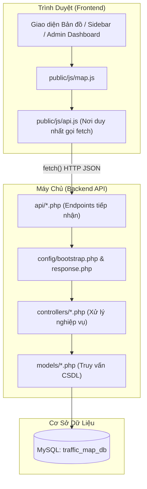

# TÀI LIỆU KIẾN TRÚC & HƯỚNG DẪN HOẠT ĐỘNG DỰ ÁN
**Hệ thống Bản đồ Cảnh báo Điểm ngập & Kẹt xe Công cộng**

---

## 1. Tổng quan Kiến trúc

Dự án được xây dựng theo kiến trúc **RESTful API kết hợp mô hình MVC tinh gọn**:
- **Frontend (Client)**: Ứng dụng Single Page hiển thị bản đồ tương tác qua thư viện **Leaflet.js** (OpenStreetMap) và CSS/JavaScript hiện đại. Mọi tương tác lấy dữ liệu hoặc gửi form đều gọi ngầm qua file API Client tập trung `public/js/api.js`.
- **Backend (Server)**: Viết bằng **PHP**, chia thành các tầng rõ ràng:
  - `api/`: Các cổng tiếp nhận request (Router / Endpoints), chỉ trả về định dạng **JSON**.
  - `controllers/`: Tầng xử lý logic nghiệp vụ (kiểm tra dữ liệu, upload ảnh, phân quyền).
  - `models/`: Tầng làm việc trực tiếp với CSDL MySQL (Prepared Statement chống SQL Injection).
- **Cơ sở dữ liệu (Database)**: MySQL `traffic_map_db`.

---

## 2. Cấu trúc Thư mục Dự án

```text
ban-do-canh-bao/
├── api/                             # Cổng API trả về JSON cho Frontend
│   ├── login.php                    # POST: Đăng nhập
│   ├── register.php                 # POST: Đăng ký
│   ├── logout.php                   # POST/GET: Đăng xuất
│   ├── me.php                       # GET: Kiểm tra phiên đăng nhập hiện tại
│   ├── reports.php                  # GET: Lấy danh sách sự cố / POST: Tạo báo cáo mới
│   ├── vote.php                     # POST: Bình chọn xác nhận đúng/sai
│   └── admin/                       # Các API dành riêng cho Quản trị viên
│       ├── users.php                # GET: Danh sách người dùng
│       └── user_status.php          # POST: Khóa / Mở khóa tài khoản
├── config/                          # Cấu hình hệ thống dùng chung
│   ├── db.php                       # Kết nối CSDL MySQL (mysqli, charset utf8mb4)
│   ├── response.php                 # Hàm chuẩn hóa JSON response (json_success, json_error)
│   ├── auth.php                     # Hàm bảo vệ (require_login, require_admin)
│   └── bootstrap.php                # Khởi động session, bắt lỗi hệ thống ra JSON
├── controllers/                     # Tầng xử lý nghiệp vụ (Business Logic)
│   ├── AuthController.php           # Logic đăng ký, đăng nhập, phân quyền session
│   ├── ReportController.php         # Logic lọc báo cáo, validate GPS, upload ảnh
│   └── AdminController.php          # Logic thống kê, đổi trạng thái thành viên
├── database/
│   └── schema.sql                   # Mã nguồn SQL khởi tạo CSDL chuẩn
├── models/                          # Tầng truy vấn CSDL (Data Access Layer)
│   ├── UserModel.php                # Tương tác bảng `users`
│   └── ReportModel.php              # Tương tác bảng `reports` và `report_votes`
├── public/                          # Tài nguyên công khai
│   ├── css/style.css                # Toàn bộ CSS giao diện
│   ├── images/reports/              # Thư mục chứa hình ảnh người dân tải lên
│   └── js/
│       ├── api.js                   # API Client tập trung (chứa toàn bộ hàm fetch)
│       └── map.js                   # Logic bản đồ Leaflet, GPS, vẽ marker, sự kiện UI
├── views/                           # Giao diện người dùng
│   ├── admin/
│   │   └── dashboard.php            # Bảng điều khiển Quản trị viên
│   └── layout/
│       ├── header.php               # Thanh trạng thái, bộ lọc, menu
│       ├── sidebar.php              # Menu trượt, form báo cáo, panel tin tức
│       └── footer.php               # Nút zoom, GPS, nhúng api.js và map.js
├── index.php                        # Điều hướng URL chính (?route=home | admin_dashboard | logout)
└── README.md                        # Giới thiệu dự án
```

---

## 3. Sơ đồ Kiến trúc & Luồng dữ liệu



---

## 4. Chi tiết các Module & Thứ tự Thực thi

### Module 1: Hiển thị Bản đồ & Tải Sự cố
* **File tham gia**: `index.php` $\rightarrow$ `views/layout/footer.php` $\rightarrow$ `public/js/map.js` $\rightarrow$ `public/js/api.js` $\rightarrow$ `api/reports.php` $\rightarrow$ `controllers/ReportController.php` $\rightarrow$ `models/ReportModel.php`.
* **Thứ tự chạy**:
  1. Người dùng truy cập `index.php` (mặc định route `home`).
  2. Trình duyệt tải Leaflet và khởi tạo bản đồ Nha Trang trong `map.js`.
  3. `map.js` tự động gọi hàm `locateUser()` để lấy GPS và gọi `loadReports()`.
  4. `loadReports()` gọi `Api.reports("all")` trong `api.js`.
  5. `api.js` gửi `GET /api/reports.php?type=all`.
  6. Backend gọi `ReportController->list()` $\rightarrow$ `ReportModel->getActiveReports()`.
  7. Dữ liệu JSON trả về client $\rightarrow$ `map.js` chạy hàm `renderMarkers()` vẽ các icon sóng xung động (xanh: ngập nước, cam: kẹt xe).
  8. Hệ thống kích hoạt hẹn giờ tự làm mới lại danh sách sau mỗi 25 giây (`setInterval`).

---

### Module 2: Báo cáo Sự cố Mới
* **File tham gia**: `views/layout/sidebar.php` (`#sidebar-report`) $\rightarrow$ `map.js` $\rightarrow$ `api.js` $\rightarrow$ `api/reports.php` $\rightarrow$ `config/auth.php` $\rightarrow$ `controllers/ReportController.php` $\rightarrow$ `models/ReportModel.php`.
* **Thứ tự chạy**:
  1. Người dùng click trực tiếp lên bản đồ (hoặc bấm nút "GPS") $\rightarrow$ `map.js` lấy tọa độ `lat`, `lng` tự điền vào form và mở khung báo cáo.
  2. Người dùng chọn mức độ (nhẹ/vừa/nghiêm trọng), đính kèm ảnh và bấm **"Gửi Báo Cáo"**.
  3. `handleReportFormSubmit()` chặn reload trang mặc định và chuyển `FormData` cho `Api.addReport(formData)`.
  4. `api/reports.php` nhận `POST`, chạy `require_login()` kiểm tra session hợp lệ.
  5. `ReportController->create()` validate tọa độ, kiểm tra định dạng và kích thước ảnh $\rightarrow$ lưu file vật lý vào `public/images/reports/`.
  6. `ReportModel->createReport()` lưu bản ghi vào bảng `reports`.
  7. API trả về `{ status: "success", message: "Gửi báo cáo sự cố thành công!" }`.
  8. `map.js` hiển thị thông báo popup Toast mượt mà, đóng form và gọi ngay `loadReports()` để ghim điểm ngập vừa báo lên bản đồ tức thì.

---

### Module 3: Bình chọn / Xác nhận Sự cố (Chống tin giả)
* **File tham gia**: `map.js` (`voteReport`) $\rightarrow$ `api.js` (`Api.vote`) $\rightarrow$ `api/vote.php` $\rightarrow$ `controllers/ReportController.php` $\rightarrow$ `models/ReportModel.php`.
* **Thứ tự chạy**:
  1. Trên popup của điểm sự cố, người dùng bấm **"👍 Đúng"** hoặc **"👎 Đã hết"**.
  2. `map.js` kiểm tra biến `isLoggedIn`: nếu chưa đăng nhập thì tự mở panel Đăng nhập; nếu đã đăng nhập thì gọi `Api.vote(id, type)`.
  3. `api/vote.php` gọi `ReportController->vote()` $\rightarrow$ `ReportModel->vote()`.
  4. Trong Model, CSDL mở **Transaction** an toàn:
     - Chặn không cho người tự báo cáo tự vote bài của chính mình.
     - Kiểm tra bảng `report_votes`: Nếu người dùng đổi ý (từ "Đúng" sang "Đã hết" hoặc ngược lại), hệ thống tự động trừ 1 phiếu ở cột cũ và cộng 1 phiếu ở cột mới. Nếu vote lần đầu, tự động cộng phiếu và lưu lịch sử.
  5. CSDL cập nhật và commit dữ liệu, trả về số lượt vote mới.
  6. Frontend gọi `loadReports()` để cập nhật con số hiển thị trên popup.

---

### Module 4: Xác thực Tài khoản (Đăng ký, Đăng nhập, Đăng xuất)
* **File tham gia**: `views/layout/sidebar.php` $\rightarrow$ `map.js` $\rightarrow$ `api.js` $\rightarrow$ `api/login.php`, `register.php`, `logout.php`, `me.php` $\rightarrow$ `controllers/AuthController.php` $\rightarrow$ `models/UserModel.php`.
* **Thứ tự chạy**:
  - **Đăng ký**: `Api.register()` $\rightarrow$ `AuthController->register()` kiểm tra username không dấu cách, email đúng định dạng, mật khẩu tối thiểu 6 ký tự $\rightarrow$ mã hóa `password_hash (BCRYPT)` $\rightarrow$ lưu vào bảng `users`.
  - **Đăng nhập**: `Api.login()` $\rightarrow$ `AuthController->login()` kiểm tra username/email, kiểm tra tài khoản có bị khóa (`status = 'blocked'`) không $\rightarrow$ khởi tạo `$_SESSION` an toàn bằng `session_regenerate_id(true)`.
  - **Đăng xuất**: Người dùng bấm nút "Đăng xuất" $\rightarrow$ điều hướng về `index.php?route=logout` $\rightarrow$ hủy toàn bộ `$_SESSION` và cookie phiên $\rightarrow$ tự động chuyển hướng về trang chủ `index.php?route=home`.

---

### Module 5: Bảng điều khiển Quản trị viên (Admin Dashboard)
* **File tham gia**: `index.php` $\rightarrow$ `views/admin/dashboard.php` $\rightarrow$ `api.js` $\rightarrow$ `api/admin/users.php`, `user_status.php` $\rightarrow$ `config/auth.php` $\rightarrow$ `controllers/AdminController.php` $\rightarrow$ `models/UserModel.php`.
* **Thứ tự chạy**:
  1. Admin đăng nhập và truy cập `index.php?route=admin_dashboard`.
  2. `index.php` xác thực `$_SESSION['role'] === 'admin'` và nạp file giao diện `views/admin/dashboard.php`.
  3. Trình duyệt tải trang xong, JavaScript gọi hàm `loadUsers()` $\rightarrow$ `Api.adminUsers()`.
  4. `api/admin/users.php` kiểm tra hàm `require_admin()` $\rightarrow$ gọi `AdminController->listUsers()` $\rightarrow$ lấy toàn bộ thành viên từ `UserModel->listAll()` $\rightarrow$ trả về JSON.
  5. JavaScript nhận JSON và render bảng danh sách người dùng kèm số điểm uy tín và trạng thái.
  6. Khi Admin bấm nút **"Khóa"** hoặc **"Mở khóa"**:
     - JavaScript gọi `Api.adminUserStatus(userId, action)`.
     - `api/admin/user_status.php` gọi `AdminController->updateUserStatus()` $\rightarrow$ cập nhật trạng thái `active` / `blocked` trong CSDL.
     - Sau khi có kết quả trả về, bảng người dùng tự động làm mới ngay lập tức mà **không cần tải lại trang**.

---

## 5. Quy chuẩn Định dạng Phản hồi API (JSON Response Standard)

Mọi API trong thư mục `api/` đều trả về cấu trúc thống nhất qua file `config/response.php`:

### Thành công (HTTP 200 / 201):
```json
{
  "status": "success",
  "message": "Gửi báo cáo sự cố thành công!",
  "data": {
    "id": 12,
    "image_url": "public/images/reports/1713580000_abc.jpg"
  }
}
```

### Thất bại (HTTP 400 / 401 / 403 / 422 / 500):
```json
{
  "status": "error",
  "message": "Vui lòng chọn vị trí hợp lệ trên bản đồ!",
  "data": null
}
```

---

## 6. Hướng dẫn Khởi chạy cho Thành viên Mới

1. **Cài đặt môi trường**: Sử dụng **XAMPP** (PHP 8.0 trở lên, Apache, MySQL).
2. **Đặt mã nguồn**: Copy toàn bộ thư mục vào `c:\xampp\htdocs\ban-do-canh-bao`.
3. **Cơ sở dữ liệu**:
   - Mở `http://localhost/phpmyadmin/`.
   - Tạo CSDL mới tên `traffic_map_db` với bảng mã `utf8mb4_unicode_ci`.
   - Chạy lệnh import nội dung file: `database/schema.sql`.
4. **Cấu hình kết nối**: Kiểm tra file `config/db.php` (mặc định user `root`, mật khẩu rỗng `''`).
5. **Truy cập ứng dụng**:
   - Giao diện bản đồ: `http://localhost/ban-do-canh-bao/`
   - Giao diện Admin: `http://localhost/ban-do-canh-bao/index.php?route=admin_dashboard`

